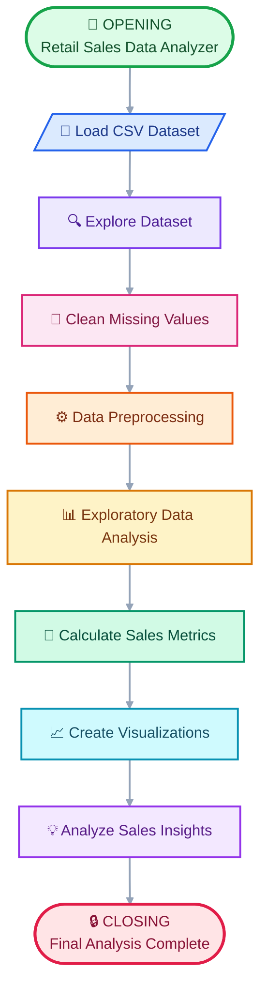

 

 

## 📊 About This Project

Retail Sales Data Analyzer is a Python-based data analysis project designed to explore, analyze, and visualize retail sales data using powerful Python libraries.
The project uses Pandas, NumPy, Matplotlib, and Seaborn to perform data cleaning, data preprocessing, exploratory data analysis (EDA), and sales trend visualization.
It helps analyze sales performance, understand product categories, calculate important sales metrics, and discover meaningful patterns in retail data.
This project demonstrates the practical application of Python programming and data analysis techniques to transform raw data into meaningful insights. 📈

## 🎨 Project Workflow

## 🛠️ Technologies & Tools Used

🛠️ Technologies & Tools Used

<table>
  <thead>
    <tr>
      <th>Technology</th>
      <th>Purpose</th>
    </tr>
  </thead>
  <tbody>
    <tr>
      <td>🐍 Python</td>
      <td>Core programming language</td>
    </tr>
    <tr>
      <td>🐼 Pandas</td>
      <td>Data cleaning and analysis</td>
    </tr>
    <tr>
      <td>🔢 NumPy</td>
      <td>Numerical calculations</td>
    </tr>
    <tr>
      <td>📊 Matplotlib</td>
      <td>Creating charts and graphs</td>
    </tr>
    <tr>
      <td>🎨 Seaborn</td>
      <td>Statistical visualization and heatmaps</td>
    </tr>
    <tr>
      <td>📓 Jupyter Notebook</td>
      <td>Writing and executing Python code</td>
    </tr>
    <tr>
      <td>📁 CSV Dataset</td>
      <td>Storing and loading retail sales data</td>
    </tr>
    <tr>
      <td>💻 Visual Studio Code</td>
      <td>Writing and managing project files</td>
    </tr>
    <tr>
      <td>🐙 GitHub</td>
      <td>Hosting the project repository</td>
    </tr>
  </tbody>
</table>

    

## 🧠 Key Insights

📊 What We Discover from Retail Sales Data

* 🛍️ Product Performance: Analyze which products contribute the most to total sales.
* 🏆 Category Comparison: Compare sales performance across different product categories.
* 📈 Sales Trends: Explore sales patterns over time using date-based analysis.
* 💰 Revenue Analysis: Calculate total sales and understand overall sales performance.
* 🔗 Correlation Analysis: Examine relationships between numerical variables using a correlation heatmap.
* 💡 Data-Driven Decisions: Use analytical findings to support better retail business decisions.

## 👩‍💻 About the Author

✨ Khushi Chaudhary ✨

Aspiring Data Analyst | Python Learner

Passionate about Python programming, data analysis, and transforming raw data into meaningful insights. 🚀

📊 Project: Retail Sales Data Analyzer

💻 Technologies: Python · Pandas · NumPy · Matplotlib · Seaborn

🌱 Currently Learning: Data Analysis & Python

